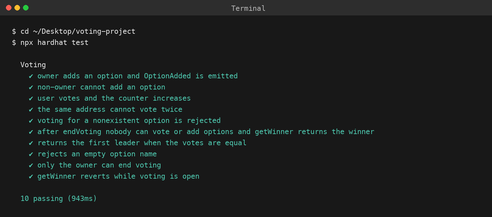
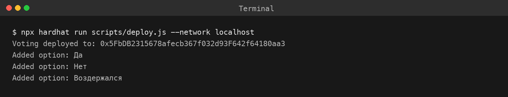

# Voting

Смарт-контракт для голосования на Solidity и Hardhat.

## Что умеет контракт

- Владелец добавляет варианты ответа.
- Участники голосуют, каждый адрес может проголосовать только один раз.
- Владелец завершает голосование.
- После завершения определяется победитель. Если голоса равны, побеждает первый лидер.

## Структура проекта

```
voting-project/
├── contracts/
│   └── Voting.sol
├── test/
│   └── Voting.test.js
├── scripts/
│   └── deploy.js
├── screenshots/
│   ├── tests.png
│   └── deploy.png
├── hardhat.config.js
├── package.json
└── README.md
```

## Установка

```bash
npm install
```

## Компиляция

```bash
npx hardhat compile
```

## Тесты

```bash
npx hardhat test
```

В проекте 10 тестов. Они проверяют добавление вариантов, права владельца, голосование, повторное голосование, несуществующий вариант, завершение голосования и определение победителя.

Ожидаемый результат:

```
10 passing
```



## Локальная сеть и деплой

Терминал 1. Запустить локальную ноду:

```bash
npx hardhat node
```

Терминал 2. Развернуть контракт:

```bash
npx hardhat run scripts/deploy.js --network localhost
```

Скрипт деплоя сразу добавляет три варианта: `Да`, `Нет`, `Воздержался`.



## Адрес контракта

После деплоя в локальной сети:

```
0x5FbDB2315678afecb367f032d93F642f64180aa3
```

## Зависимости

Проект использует Hardhat 2 и `@nomicfoundation/hardhat-toolbox@hh2`. Версия `hh2` нужна для совместимости с Hardhat 2.

## Часть 2

Структура проекта сохранена полностью. Её можно использовать для подключения React-приложения.
